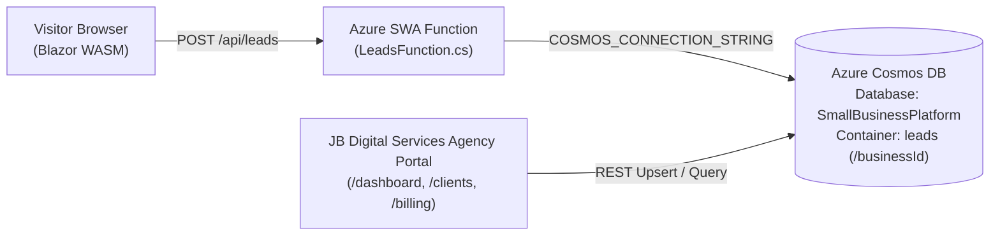

# 10:16 Automotive — Official Website & Lead Capture Platform

A high-performance small business website and lead dispatch platform built with **Blazor WebAssembly (.NET 10)**, **Azure Static Web Apps Managed Functions (.NET 10)**, **Azure Cosmos DB Free Tier**, and **Stripe Hosted Billing Integration** on the **JB Digital Services** agency architecture.

* **Client Business**: **10:16 Automotive**
* **Owner / Lead Specialist**: **Donny Bliss** (6-Year U.S. Army Veteran)
* **Location**: Cleveland & Bradley County, TN
* **Core Offerings**: Geoshield Nano-Ceramic Window Tint, Custom Vinyl & Camouflage Wraps, Certified System X 9H Ceramic Protections, Detailing & Paint Correction
* **Suppliers & Certifications**: Certified System X Ceramic Protections & Authorized Geoshield Tint Supplier
* **Business History**: Operating since 2020; officially incorporated January 2026; expanding from home shop to full commercial shop
* **Facebook Business Page**: [https://www.facebook.com/profile.php?id=61584622472913](https://www.facebook.com/profile.php?id=61584622472913)
* **Instagram Profile**: [https://www.instagram.com/1016auto/](https://www.instagram.com/1016auto/)
* **Agency Portal Management**: Registered tenant `1016-automotive` in the [JB Digital Services Agency Management Portal](https://purple-flower-020acac0f.4.azurestaticapps.net)

---

## Design System & Tactical Theme

* **Tactical Army Palette**:
  * **Primary (Army Olive Green)**: `#2C3E2D`
  * **Accent (Tactical Coyote Gold / Amber)**: `#D49A3D`
  * **Surface (Stealth Matte Slate)**: `#18221A`
  * **Background (Dark Charcoal Black)**: `#0D120F`
* **Sharp Vector Typography**:
  * Headings: **Rajdhani** (crisp, technical geometric styling)
  * Body: **Barlow** (clean, high-legibility sans-serif)
* **Sharp Vector Icons**:
  * Replaced soft emoji icons with sharp SVG vector icons: crosshair, tactical chevron shield, diamond ceramic armor, sun UV deflector, vinyl wrap blade, and military veteran star.
* **100% Authentic Imagery**:
  * Zero AI generated images. Uses only actual photography uploaded by the user and scraped directly from Donny Bliss's official Facebook and Instagram profiles.

---

## Core Features & Pages

1. **Mission Showcase Marquee & Photo Directory (`Client/Components/WorkShowcase.razor`)**:
   * Continuous smooth horizontal marquee carousel with hover pause.
   * Full-screen interactive lightbox modal with technical build specifications.
   * Filterable photo directory categorized by: All Builds, Window Tint, Vinyl Wraps, and Ceramic Protection.
2. **Interactive Window Tint Shade Selector**:
   * Interactive simulator for testing Geoshield tint darkness (5% Limo, 20% Dark Match, 35% Tennessee Legal Net, 50% Smoke, 70% Clear Ceramic) with live heat rejection and UV block stats.
3. **Dedicated Socials & Feeds Page (`/socials`)**:
   * Direct social feed integration cards for Facebook (`@10:16 Automotive`) and Instagram (`@1016auto`).
   * Live stats, bio quotes, recent photo drops, and community hashtag sharing (`#1016Auto`).
4. **Founder Story & Veteran Pride (`/about`)**:
   * Documents Donny Bliss's 6-year Army service, discipline, shop progression, and 10% military & first responder discount.
5. **Specialized Services Breakdown (`/services`)**:
   * In-depth specifications for Geoshield ceramic window film, custom cast vinyl wraps, and System X 9H quartz coatings.
6. **Lead & Estimate Intake (`/contact`)**:
   * Vehicle year/make/model intake, service selection, timeframe, honeypot protection, and Cosmos DB dispatch.

---

## Agency Platform & Infrastructure

---

## Launch & Configuration Checklist

* [x] Registered tenant in JB Digital Services Agency Portal (`1016-automotive`).
* [x] Configured `appsettings.json` with tactical army palette and complete business metadata.
* [x] Integrated authentic client work photos and official logo emblem.
* [x] Synchronized static SEO tags, sitemap.xml, robots.txt, and manifest.webmanifest.
* [ ] Domain acquisition and Cloudflare DNS setup (pending client domain purchase).
* [ ] Cloudflare Email Routing & Brevo outbound alert configuration.
